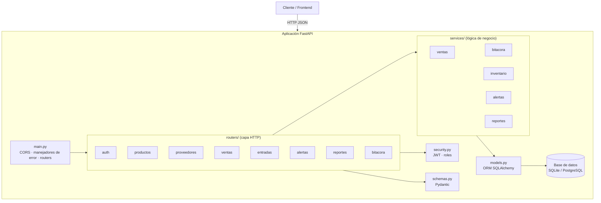

# Arquitectura

El backend es una API REST en **FastAPI** con arquitectura por capas. Cada capa
tiene una responsabilidad única y las dependencias apuntan siempre hacia el
interior: `routers → services → models`.

## Capas

| Capa | Carpeta | Responsabilidad |
|------|---------|-----------------|
| **HTTP / Routers** | `backend/app/routers/` | Validar entrada/salida, aplicar autenticación y roles, mapear a respuestas. |
| **Servicios** | `backend/app/services/` | Lógica de negocio: ventas, inventario, alertas, reportes, bitácora. |
| **Datos / Modelos** | `backend/app/models.py` | Modelos ORM (SQLAlchemy 2) y acceso a la base de datos. |

Transversales a todas las capas:

| Módulo | Archivo | Función |
|--------|---------|---------|
| Configuración | `app/config.py` | Variables de entorno y reglas parametrizables (`Settings`). |
| Base de datos | `app/database.py` | `engine`, `SessionLocal`, `get_db`, `crear_tablas`. |
| Esquemas | `app/schemas.py` | Validación y serialización (Pydantic v2). |
| Seguridad | `app/security.py` | Hash de contraseñas, JWT, roles, bloqueo por intentos. |
| Errores | `app/errors.py` | `APIError` y manejadores con formato `{error, detalle}`. |
| Utilidades | `app/utils.py` | Fechas UTC y rangos de día. |

## Diagrama de capas



## Flujo de una petición

Ejemplo: `POST /ventas` (registrar una venta).

1. **main.py** enruta a `routers/ventas.py`.
2. El router resuelve dependencias: `get_db` (sesión) y `get_current_user`
   (JWT → usuario de `security.py`).
3. El router valida el cuerpo con `schemas.VentaCreate` y llama a
   `services/ventas.crear_venta`.
4. El servicio aplica las reglas de negocio (idempotencia por `client_uuid`,
   validación y descuento de stock), usa `services/alertas` para evaluar alertas
   y `services/bitacora` para auditar.
5. Los modelos ORM persisten en la base de datos y el router devuelve la venta
   serializada con `VentaOut`.
6. Cualquier error controlado (`APIError`) se convierte en `{error, detalle}`
   mediante los manejadores de `errors.py`.

## Reglas de dependencia

- `routers` conocen `services`, `schemas` y `security`.
- `services` conocen `models`, `config` y otros `services`.
- `models` no conoce ni `routers` ni `services`.
- La sesión de base de datos se inyecta con `Depends(get_db)`; los servicios la
  reciben como parámetro (no la crean).

## Estructura de carpetas

```
backend/
├─ app/
│  ├─ main.py            # app, CORS, manejadores de error, routers
│  ├─ config.py          # Settings (variables de entorno)
│  ├─ database.py        # engine, sesión, creación de tablas
│  ├─ models.py          # 8 modelos ORM
│  ├─ schemas.py         # esquemas Pydantic
│  ├─ security.py        # bcrypt, JWT, roles, bloqueo de login
│  ├─ errors.py          # APIError y manejadores
│  ├─ utils.py           # fechas UTC y rango_dia
│  ├─ routers/           # capa HTTP (auth, productos, ...)
│  └─ services/          # lógica de negocio
├─ scripts/
│  ├─ seed.py            # datos de demo reproducibles
│  ├─ backup.py          # respaldo
│  └─ entrypoint.py      # arranque del contenedor (espera DB, seed, uvicorn)
├─ tests/                # pytest (matriz B-01..B-15)
├─ Dockerfile
├─ requirements.txt
└─ .env.example
docker-compose.yml       # api + db (PostgreSQL)
docs/                    # esta documentación
frontend/                # aplicación de frontend (otra rama)
```

## Decisiones de diseño

- **Sesión por petición:** `get_db` abre y cierra una sesión por request.
- **Errores uniformes:** todo error sale con la misma forma `{error, detalle}`.
- **Bitácora en transacción propia:** `services/bitacora.registrar` confirma de
  inmediato para que el registro sobreviva aunque la operación principal falle.
- **Portabilidad de BD:** solo se usa ORM y SQL estándar; los filtros por día usan
  rangos de `datetime` (`utils.rango_dia`) para funcionar igual en SQLite y Postgres.
- **Sin migraciones:** las tablas se crean con `Base.metadata.create_all`
  (no hay Alembic en esta versión).

## Documentos relacionados

- [Modelo de datos](./modelo-datos.md)
- [Reglas de negocio](./reglas-negocio.md)
- [Referencia de endpoints](./api-endpoints/README.md)
