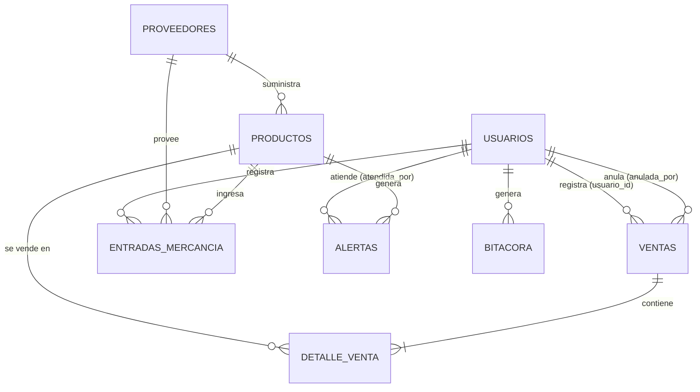

# Modelo de datos

Base de datos relacional gestionada con **SQLAlchemy 2** (`backend/app/models.py`).
Funciona igual sobre **SQLite** (desarrollo) y **PostgreSQL** (Docker/producción).

> El proyecto menciona "9 tablas", pero en el código actual hay **8 tablas**
> (8 clases en `models.py`). Este documento describe esas 8.

## Diagrama entidad-relación

## Tablas

### `usuarios`
Usuarios del sistema (admin y vendedor).

| Columna          | Tipo         | Restricciones                    |
|------------------|--------------|----------------------------------|
| `id`             | int          | PK                               |
| `nombre_usuario` | string(50)   | único, indexado, no nulo         |
| `nombre_completo`| string(120)  | no nulo                          |
| `password_hash`  | string(255)  | no nulo (bcrypt)                 |
| `rol`            | string(20)   | no nulo, por defecto `vendedor`  |
| `activo`         | boolean      | no nulo, por defecto `true`      |

### `proveedores`

| Columna        | Tipo         | Restricciones              |
|----------------|--------------|----------------------------|
| `id`           | int          | PK                         |
| `nombre`       | string(120)  | no nulo                    |
| `telefono`     | string(40)   | nulo                       |
| `correo`       | string(120)  | nulo                       |
| `dias_entrega` | int          | no nulo, por defecto `0`   |
| `activo`       | boolean      | no nulo, por defecto `true`|

### `productos`

| Columna        | Tipo         | Restricciones                          |
|----------------|--------------|----------------------------------------|
| `id`           | int          | PK                                     |
| `codigo`       | string(50)   | único, indexado, no nulo               |
| `nombre`       | string(150)  | no nulo                                |
| `categoria`    | string(80)   | nulo                                   |
| `unidad`       | string(30)   | no nulo, por defecto `unidad`          |
| `precio_venta` | float        | no nulo, por defecto `0`               |
| `costo`        | float        | no nulo, por defecto `0`               |
| `stock_actual` | float        | no nulo, por defecto `0`               |
| `stock_minimo` | float        | no nulo, por defecto `0`               |
| `proveedor_id` | int          | FK → `proveedores.id`, nulo            |
| `activo`       | boolean      | no nulo, por defecto `true`            |

### `ventas`
Cabecera de la venta.

| Columna           | Tipo         | Restricciones                          |
|-------------------|--------------|----------------------------------------|
| `id`              | int          | PK                                     |
| `client_uuid`     | string(80)   | único, indexado, no nulo (idempotencia)|
| `fecha`           | datetime     | no nulo (UTC)                          |
| `usuario_id`      | int          | FK → `usuarios.id`, no nulo            |
| `total`           | float        | no nulo, por defecto `0`               |
| `estado`          | string(20)   | no nulo, por defecto `completada`      |
| `motivo_anulacion`| text         | nulo                                   |
| `anulada_por`     | int          | FK → `usuarios.id`, nulo               |

### `detalle_venta`
Líneas de cada venta (relación 1:N con cascada de borrado).

| Columna          | Tipo       | Restricciones                |
|------------------|------------|------------------------------|
| `id`             | int        | PK                           |
| `venta_id`       | int        | FK → `ventas.id`, no nulo    |
| `producto_id`    | int        | FK → `productos.id`, no nulo |
| `cantidad`       | float      | no nulo                      |
| `precio_unitario`| float      | no nulo                      |
| `subtotal`       | float      | no nulo                      |

### `entradas_mercancia`

| Columna          | Tipo     | Restricciones                |
|------------------|----------|------------------------------|
| `id`             | int      | PK                           |
| `fecha`          | datetime | no nulo (UTC)                |
| `proveedor_id`   | int      | FK → `proveedores.id`, nulo  |
| `producto_id`    | int      | FK → `productos.id`, no nulo |
| `cantidad`       | float    | no nulo                      |
| `costo_unitario` | float    | no nulo                      |
| `usuario_id`     | int      | FK → `usuarios.id`, no nulo  |

### `alertas`

| Columna            | Tipo     | Restricciones               |
|--------------------|----------|-----------------------------|
| `id`               | int      | PK                          |
| `producto_id`      | int      | FK → `productos.id`, no nulo|
| `fecha_creada`     | datetime | no nulo (UTC)               |
| `stock_al_generar` | float    | no nulo                     |
| `cantidad_sugerida`| float    | no nulo                     |
| `confianza`        | string(20)| no nulo, por defecto `normal`|
| `estado`           | string(20)| no nulo, por defecto `pendiente`|
| `fecha_atendida`   | datetime | nulo                        |
| `atendida_por`     | int      | FK → `usuarios.id`, nulo    |

### `bitacora`
Auditoría de solo-anexado (nunca se edita ni borra).

| Columna          | Tipo         | Restricciones                    |
|------------------|--------------|----------------------------------|
| `id`             | int          | PK                               |
| `fecha`          | datetime     | no nulo (UTC)                    |
| `usuario_id`     | int          | FK → `usuarios.id`, nulo         |
| `usuario_nombre` | string(120)  | nulo                             |
| `accion`         | string(40)   | no nulo                          |
| `entidad`        | string(40)   | nulo                             |
| `entidad_id`     | string(80)   | nulo                             |
| `resultado`      | string(10)   | no nulo, por defecto `ok`        |
| `detalle`        | text         | nulo                             |

## Notas

- **Fechas:** todas se guardan en **UTC sin zona** (`utils.ahora_utc`).
- **Montos:** `float`; el servidor redondea los totales a 2 decimales.
- **Estados:** `ventas.estado` ∈ `completada`, `anulada`; `alertas.estado` ∈
  `pendiente`, `atendida`; `alertas.confianza` ∈ `normal`, `baja`.
- **Índices:** `usuarios.nombre_usuario`, `productos.codigo` y `ventas.client_uuid`
  son únicos e indexados.
- **Creación del esquema:** `Base.metadata.create_all` en el arranque (y en el seed).

## Documentos relacionados

- [Arquitectura](./arquitectura.md)
- [Reglas de negocio](./reglas-negocio.md)
